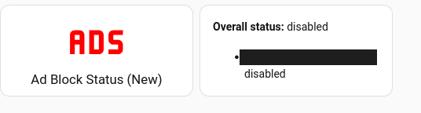
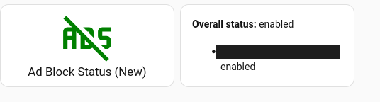

# AdBlock Manager (Home Assistant Integration)

Home Assistant custom integration for Technitium DNS and Pi-hole (v5/v6), installable via [HACS](https://hacs.xyz/) as a custom repository.

## Installation

1. In HACS, go to **Custom repositories** and add `https://github.com/kbarter/ha-adblock-manager` as an **Integration**.
2. Install "AdBlock Manager" from HACS, then restart Home Assistant.
3. **Settings > Devices & Services > Add Integration**, search for "AdBlock Manager", and follow the setup flow. Add it once per server - Technitium or Pi-hole, mixing both is fine.

Requires Home Assistant 2024.12 or newer.

## What it adds

Per configured server: a `switch` for enabling/disabling blocking, and a `sensor` reporting `enabled`/`disabled`/`error`. A `disable_for` service pauses blocking on a server for a set number of minutes, so you don't have to remember to turn it back on.

Adds a `switch.adblock_overall` that turns every configured server's blocking on/off together, and a `sensor.adblock_overall_status` reporting `enabled`/`disabled`/`partial`/`error` across all servers. Each server's status is available as an attribute. This is created even if there is only a single server.

Poll interval and SSL verification are adjustable per server after setup, from the integration's options.

## Dashboard example

| Off | On |
|---|---|
|  |  |

Both examples use [button-card](https://github.com/custom-cards/button-card) - install it from HACS under Frontend if you don't already have it.

### Option 1: combined card

```yaml
type: horizontal-stack
cards:
  - type: custom:button-card
    entity: sensor.adblock_overall_status
    name: Ad Block Status
    icon: mdi:advertisements
    color_type: icon
    tap_action:
      action: perform-action
      perform_action: switch.toggle
      target:
        entity_id: switch.adblock_overall
    state:
      - value: enabled
        icon: mdi:advertisements-off
        color: green
      - value: disabled
        icon: mdi:advertisements
        color: red
      - value: partial
        icon: mdi:advertisements
        color: yellow
      - value: error
    styles:
      card:
        - height: 100%
  - type: markdown
    content: >-
      **Overall Status:** {{ states('sensor.adblock_overall_status') | title }}

      
      - **{{ name }}:** {{ status }}
      
title: Adblock
```

### Option 2: separate cards

```yaml
type: custom:button-card
entity: sensor.adblock_overall_status
name: Ad Block Status
tap_action:
  action: perform-action
  perform_action: switch.toggle
  target:
    entity_id: switch.adblock_overall
state:
  - value: enabled
    icon: mdi:advertisements-off
    color: green
  - value: disabled
    icon: mdi:advertisements
    color: red
  - value: partial
    icon: mdi:advertisements
    color: yellow
```

Pair it with a card reading `sensor.adblock_overall_status`'s attributes for the per-server breakdown - an [entity-attributes card](https://www.home-assistant.io/dashboards/entities/), or a `markdown` card:

```yaml
type: markdown
content: >
  **Overall status:** {{ states('sensor.adblock_overall_status') }}

  
  - **{{ name }}:** {{ status }}
  
```

## Background

Started as a personal script for Pi-hole, later ported to Technitium after switching servers. That script was never published.

## AI assistance

The script this integration is based on was written by hand. This Home Assistant integration ports that script's logic and adds the code Home Assistant requires for a custom integration. The port to Home Assistant integration used AI.

---

MIT licensed.
